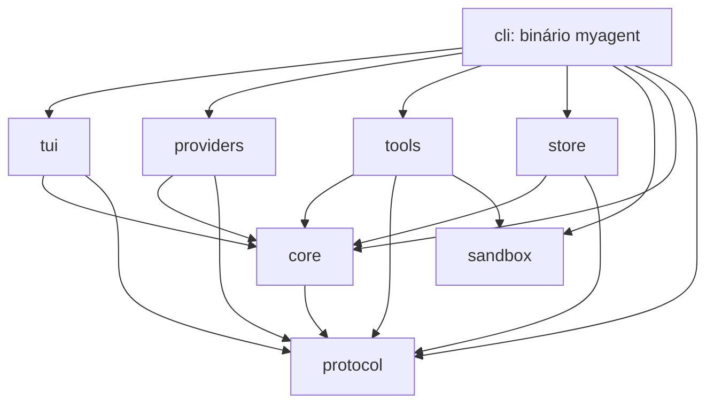

# ADR 0001 — Workspace, núcleo e adapters do My-Agent

- Data: 19/10/2026.
- Estado: **aceito** pelo usuário em 19/10/2026; decisões registradas ao final.
- Escopo: arquitetura e esqueleto compilável; não implementar o agente, acesso a
  bancos, providers, ferramentas, sandbox ou TUI nesta etapa.
- Base: [matriz de paridade](../PARITY.md) e código do My-Code-Agent, somente leitura.

## Contexto e critérios

O produto é um assistente local de terminal com paridade funcional, não uma
tradução dos pacotes TypeScript. As fronteiras precisam preservar PLAN/BUILD,
aprovações, contexto limitado, recuperação sem replay de efeitos, SQLite e
sandbox Docker. Windows, Linux e macOS têm a mesma prioridade de suporte.

Evidências no legado, relativas a `C:\Users\joaof\My-Code-Agent`:

- `packages/myagent/src/cli.ts` inicia servidor e CUI **no mesmo processo**,
  usando loopback, porta livre e token efêmero. HTTP não fornece isolamento de
  falhas entre esses componentes no launcher atual.
- `packages/shared/src/schemas.ts` define mensagens, parts, eventos e IDs de
  chamadas; `cui/src/hooks/use-chat.ts` consome SSE e reconcilia estado.
- `packages/server/src/tools/index.ts` monta listas distintas por modo;
  `security/tool-policy.ts` verifica autorização antes de executar.
- `services/generation-journal.ts` grava chamadas antes do efeito e resultados
  antes da próxima etapa do modelo; retomada recusa efeitos já iniciados.
- `services/session-lease.ts`, `session-context.ts` e `context-plan.ts` separam
  exclusão entre processos, projeção de contexto e orçamento por modelo.
- `lib/source-analysis.ts` encerra um worker de parsing ao concluir/cancelar:
  trocar o parser exige preservar limites e cancelamento, não apenas extrair nomes.

Os três primeiros caminhos acima são abreviados por pacote nas referências
subsequentes. Os contratos funcionais da matriz permanecem pendentes até serem
portados e testados; este ADR não declara paridade por existir um esqueleto.

## Alternativas de organização

| Alternativa | Ganhos | Custos | Recomendação |
| --- | --- | --- | --- |
| Um crate com módulos | Poucos manifests e refatoração inicial simples. | Fronteiras de I/O e dependências ficam fáceis de atravessar; CLI/TUI tendem a conhecer detalhes do banco/providers. | Não escolher para o port completo. |
| Workspace com oito crates | Dependências verificadas pelo Cargo, adapters substituíveis, testes por fronteira e um binário público. | Mais manifests; exige disciplina para não transformar core/protocol em depósitos de utilitários. | **Escolher.** |
| Serviços/processos separados desde o início | Possibilita backend independente e isolamento de falhas. | IPC, autenticação, distribuição e recuperação de transporte antes de haver necessidade de cliente remoto. | Adiar; pode ser implementado como adapter depois. |

## Fronteiras e direção das dependências

Usar diretórios `crates/{protocol,core,providers,tools,sandbox,store,tui,cli}`.
Os pacotes têm prefixo `myagent-` para evitar confusão com `core` da biblioteca
padrão; o executável público chama-se **myagent**. A raiz é um workspace virtual,
com versão/edição/MSRV/licença comuns e resolver 3. Não publicar crates nesta etapa.

As setas indicam **depende de**, não fluxo de mensagens:

| Crate | Responsabilidade e limites | Dependências internas |
| --- | --- | --- |
| protocol | DTOs serde de mensagens, parts, eventos, IDs, modos e estados públicos. Sem I/O, runtime, tipos SQL/HTTP/terminal ou credenciais. Serializar não substitui validar limites/regras no ingresso. | Nenhuma. |
| core | Sessões, ciclo da geração, contexto, política, limites, aprovações e contratos das portas. Orquestra I/O **pelas portas**; não conhece adapters concretos. | protocol |
| providers | Adapters Anthropic/OpenAI/Google/Ollama/ChatGPT, codecs de streaming e configuração específica; implementa a porta do core. Não executa ferramentas nem escolhe políticas de aprovação. | core, protocol |
| tools | Registro por modo/capacidade e ferramentas de arquivo, Git, web e inspeção. Executores não são disponibilizados sem os wrappers de segurança. | core, protocol, sandbox |
| sandbox | Primitivas de confinamento de caminhos, snapshot filtrado e execução Docker, limites, timeout e encerramento. Não contém decisões de sessão ou UI. | Nenhuma. |
| store | SQLite, migrations, journal, contexto persistido, leases e retenção; implementa a porta de persistência. Não instancia o loop. | core, protocol |
| tui | Estado de apresentação, entrada/teclado/temas e exibição de eventos. Envia comandos e decisões; não acessa banco, providers ou executores diretamente. | core, protocol |
| cli | Parsing, composição/injeção de adapters, configuração do runtime e diagnóstico; escolhe TUI ou consumidor headless. Ajuda/versão não abrem runtime, banco, credenciais ou Docker. | Todos os demais. |

Esta distribuição corrige um ciclo comum da sugestão inicial: **core não depende
de providers/tools/store**. As portas ficam no core e os adapters dependem delas.
O core também não depende da TUI; expõe comandos/eventos para qualquer consumidor.
Sandbox não depende de tools: ferramentas usam suas primitivas, nunca o inverso.

DTOs de wire/durabilidade pertencem a protocol; transações e tipos de conexão
ficam em store. Implementar portas mínimas conforme os casos de uso, sem criar
agora um framework de plugins, um service locator ou traits vazias especulativas.
Futuros métodos assíncronos de portas podem devolver futures boxed de `std`
para permitir injeção dinâmica sem adicionar async-trait por antecipação.

Os manifests do esqueleto materializam esse DAG com dependências locais; libs
vazias não significam adapters já conectados. `cargo metadata --no-deps` e o
check do workspace permitem conferir membros e fronteiras sem testar features.

## Transporte: HTTP/SSE ou canais no processo

| Aspecto | Manter HTTP local, token e SSE | Um processo, canais assíncronos |
| --- | --- | --- |
| Paridade da API | Conserva rotas, cabeçalhos e integração com clientes existentes. | Conserva comportamentos por comandos/eventos, mas não mantém compatibilidade das rotas. |
| Superfície de transporte | Exige bind loopback, token, validação de Host/Origin, limite de body e codecs SSE/JSON. | Remove porta/token internos e essas falhas de transporte; ainda exige validar dados recebidos, permissões e limites. |
| Falhas | Pode virar backend separado; no launcher legado já compartilha o processo com a UI. | Falha fatal pode derrubar UI e core; journal/leases continuam necessários. |
| Exec/headless | Reutiliza endpoints e parser SSE. | Reutiliza o mesmo core com outro consumidor; JSONL público continua possível sem servidor. |
| Custo | Serialização, requests, descoberta de porta e lifecycle do servidor. | Tipos compartilhados e filas explícitas; exige desenhar backpressure, ordenação e shutdown. |
| Testes e diagnóstico | Testes HTTP reais mais integração; fácil inspecionar tráfego sanitizado. | Testes do core com portas simuladas e gravação sanitizada de eventos; integração HTTP só se houver adapter. |

**Decisão aceita: um processo com canais Tokio**, sem servidor HTTP interno
obrigatório nem compatibilidade das rotas HTTP/SSE do legado nesta arquitetura.
API-01/API-02 da matriz continuam como referências de comportamentos e segurança:
validar workspace, sessão e ações continua obrigatório, enquanto token, Host/Origin
e o transporte HTTP interno deixam de ser necessários sem um listener.
Se forem necessários clientes HTTP no futuro, um crate adapter
adicional poderá expor as portas sem mover regras de segurança para handlers.
Nesse caso deverão voltar token, Host/Origin, limites e testes do transporte.

O transporte recomendado terá uma fila limitada de comandos e outra de eventos
por consumidor/geração. `mpsc` limitado aplica backpressure; `oneshot` atende
respostas pontuais; cancelamento deve ter caminho independente, como `watch`,
para não ficar preso atrás de deltas. São capacidades documentadas no
[Tokio mpsc](https://docs.rs/tokio/latest/tokio/sync/mpsc/).

Regras para implementar posteriormente:

1. O core é o dono do lifecycle; comandos incluem sessionId/generationId e
   aprovações incluem toolCallId/approvalId e escopo. Não transmitir credenciais
   nos eventos de apresentação.
2. Não descartar eventos críticos de journal, aprovação, uso ou término. Coalescer
   deltas somente preservando conteúdo/ordem; fechamento do canal não é sucesso.
3. Persistir antes de executar efeitos e antes de apresentar resultados como
   duráveis. Journal é a fonte de recuperação; canal não é event store.
4. Negar/cancelar aprovações se consumidor sumir; respeitar deadline e grants
   por sessão. Cancelar geração, encerrar trabalhos e liberar leases no shutdown.
5. Não usar broadcast com perda de mensagens como único transporte de eventos
   críticos. Futuro cliente reconstrói estado persistido antes de continuar.

SSE/JSONL continuam relevantes nos providers e na saída pública de exec. Remover
SSE **entre UI e core** não remove a necessidade de codecs de provider nem a
persistência dos pares de ferramentas.

## Crates recomendadas e momento de adoção

Escolha arquitetural não é autorização para adicionar todas as dependências
agora. Adicionar uma crate quando houver implementação que a use, registrar
features/licença/MSRV e atualizar Cargo.lock; não usar dependências `*` ou Git
sem necessidade documentada. As referências abaixo são documentação primária
consultada para este ADR, não resultados de benchmarks locais.

| Necessidade | Escolha | Justificativa, alternativa e adoção |
| --- | --- | --- |
| Runtime/canais | tokio | Runtime para rede/processos/timers e filas limitadas, com features específicas por consumidor, sem `full` por padrão. Runtime criado em cli; protocol permanece independente. Adotar quando o primeiro fluxo assíncrono existir. |
| HTTP/TLS de saída | reqwest com rustls | Client async reutilizado, streaming e configuração explícita de TLS/redirect/timeout/DNS. Desativar features padrão e habilitar rustls conforme a versão escolhida, sem assumir o nome da feature de outra major. Comparado a hyper, reduz plumbing; comparado a native-tls, evita depender do backend TLS nativo para esta decisão. Política de SSRF é nossa: validar/pinar destino e cada redirect, limitar bytes descomprimidos e não herdar proxies permissivos. Não basta escolher reqwest. [ClientBuilder](https://docs.rs/reqwest/latest/reqwest/struct.ClientBuilder.html). |
| Contratos | serde e serde_json | Serde entra no M1 por decisão do usuário; serde_json quando houver consumo concreto de JSON. Derives para DTOs tipados; JSON somente nas fronteiras de providers, persistência e exec. Fixar tags/IDs quando os contratos forem portados; limites antes/durante parsing. Não serializar tipos internos do SDK como schema do banco. [Serde](https://serde.rs/derive.html). |
| SQLite | **rusqlite com bundled** | SQL explícito, migrations embutidas/transacionais e conexão local sem exigir SQLite instalado no runtime. Conexão com dono único em thread dedicada, fila limitada e respostas por oneshot. Feature bundled exige compilador C no build; revisar versão SQLite incluída. [rusqlite](https://github.com/rusqlite/rusqlite). |
| CLI completa | clap | Adoção no M1 por decisão do usuário, substituindo o despacho mínimo por std. Modelo declarativo para comandos, validação, ajuda/versão e códigos de erro; builder ou derive conforme a CLI precisar. Evita expandir parser próprio para resume/exec/doctor. [clap](https://docs.rs/clap/latest/clap/). |
| Diagnóstico | tracing; tracing-subscriber na cli | Spans por sessão/geração/chamada e subscriber único no executável. Campos em allowlist, sem prompts/keys/args brutos nem Debug de credenciais; stderr ou destino explícito que não contamine TUI/JSONL. Não criar logs em disco nesta etapa. [tracing](https://docs.rs/tracing/latest/tracing/). |
| Erros | thiserror nas libs; anyhow na composição CLI | Erros tipados permitem diferenciar negação, cancelamento, limite, provider, banco e ambiente. Anyhow adiciona contexto no topo sem virar contrato público. Sanitizar ao apresentar, não imprimir cadeias arbitrárias de respostas/credenciais. [thiserror](https://docs.rs/thiserror/latest/thiserror/), [anyhow](https://docs.rs/anyhow/latest/anyhow/). |
| Terminal | ratatui + crossterm | Renderização e input separados; backend multiplataforma, TestBackend para telas e estado puro para testar navegação. Restoration de raw mode/alternate screen mesmo em erro, foco por camada e resize. Termion não é escolha principal devido ao suporte Windows exigido. [Backends Ratatui](https://ratatui.rs/concepts/backends/). |
| Prévia de diff | similar | Diff de texto para aprovação e resumo; não é motor de aplicação de patch nem mecanismo de undo. Limitar custo/saída, preservar bytes/CRLF/mode em escrita e checkpoint. Não normalizar o arquivo inteiro para mostrar uma prévia. [similar](https://docs.rs/similar/latest/similar/). |
| Busca/ignore | ignore + globset | Reutilizar parsing de ignores e matching de globs. Começar por GitignoreBuilder/add_line com leitura limitada do ignore da raiz; não adotar defaults que leiam ignores de pais/globais/aninhados ou .git sem paridade autorizada. Walker nunca segue links/junctions; exclusões de segredos prevalecem sobre negações. [ignore](https://docs.rs/ignore/latest/ignore/), [globset](https://docs.rs/globset/latest/globset/). |
| Outline JS/TS | **tree-sitter**, tree-sitter-javascript e tree-sitter-typescript | Árvore sintática e consultas de declarações, JSX/TSX, arquivos incompletos e callback de progresso para cancelar/deadline. Não equivale a typecheck ou referências. Gramáticas trazem C/FFI transitivo, sem unsafe próprio. Fixar versões de runtime/gramáticas compatíveis. [Parser](https://docs.rs/tree-sitter/latest/tree_sitter/struct.Parser.html), [ParseOptions](https://docs.rs/tree-sitter/latest/tree_sitter/struct.ParseOptions.html). |

### rusqlite versus sqlx

SQLx também oferece SQLite, APIs async, pool e query macros; as macros verificadas
dependem de schema disponível ou metadados offline. É uma alternativa válida se
o produto precisar de mais bancos/consultas concorrentes com esse modelo.
Sua [documentação SQLite](https://docs.rs/sqlx/latest/sqlx/sqlite/) descreve o adapter.

Para um banco local, journal com ordem explícita e leases entre processos, não
há necessidade demonstrada de múltiplos bancos ou de um pool. Recomendo rusqlite
com um worker de conexão para manter o bloqueio fora do executor. Não compartilhar
uma Connection em Arc sem estratégia de ownership, nem segurar mutex síncrono
através de await. Transações devem agrupar operações de durabilidade necessárias;
WAL/busy_timeout não substituem leases e não garantem ausência de contenção.

Cancelamento não desfaz uma transação já confirmada. Toda requisição do worker
deve terminar ou reportar efeito desconhecido de forma recuperável; shutdown
espera operações pendentes com limite explícito. Trabalho contínuo usa thread
dedicada: abort de `spawn_blocking` não interrompe trabalho já iniciado, conforme
[Tokio](https://docs.rs/tokio/latest/tokio/task/fn.spawn_blocking.html).

### Parser: tree-sitter versus Oxc/SWC

[Oxc](https://docs.rs/oxc_parser/latest/oxc_parser/) é uma alternativa em Rust com
AST JS/TS/JSX/TSX, adequada se precisarmos de análise mais próxima do compilador.
SWC oferece um ecossistema de parsing/transformação mais amplo do que o outline
necessita. Nenhuma opção deve executar configuração do projeto.

Recomendo tree-sitter pelo escopo sintático, recuperação de erro e cancelamento
via progresso. Validar em fixtures do legado: declarações exportadas/nested,
comentários/strings/referências não contadas como declarações, extensões JS/TS,
limites, Unicode e linhas. Respostas parciais precisam indicar truncamento/erros.
Callback é cancelamento cooperativo, não isolamento absoluto: limitar bytes,
profundidade/tempo e concorrência; não afirmar que um timeout async mata uma
thread nativa. Não há benchmark local nem parser adicionado nesta etapa.

## LLM: SDK existente ou camada própria fina

| Alternativa | Benefício | Risco/custo para esta paridade |
| --- | --- | --- |
| [genai](https://docs.rs/genai/latest/genai/) | Abstração de chat/streaming e adapters para múltiplos providers. | Exige conferir preservação de partes, IDs, reasoning, usage, autenticação e término por fixture; eventuais lacunas precisam de extensão. Não presumir incompatibilidade ou equivalência sem teste. |
| [Rig](https://docs.rs/rig-core/latest/rig_core/) | Providers, streaming, tools e abstrações de agentes; o catálogo atual inclui clientes com autenticação ChatGPT. | Agent/tool loop e tipos de memória podem disputar a autoridade do core sobre aprovações, journal, orçamento e replay. Pode ser usado como adapter se provar os contratos, sem delegar esses controles. |
| Camada própria fina sobre reqwest/serde | Controle explícito do protocolo, status terminal, credenciais, limites e eventos normalizados; core continua único dono do ciclo. | Manutenção dos dialetos, SSE incremental, renovação e testes de contrato é nossa. Evitar construir um framework genérico novo. |

**Recomendo a camada própria fina**, com uma porta comum do core e codecs por
provider. A decisão não se baseia em afirmar que SDKs não suportam ChatGPT: a
[lista atual do Rig](https://docs.rs/rig-core/latest/rig_core/providers/index.html)
já o inclui. A existência de um adapter não demonstra a equivalência ao fluxo
OAuth, às contas e à semântica de recuperação do legado.

Normalizar somente conteúdo/estados que o core entende; manter metadados opacos
necessários ao provider em estruturas versionadas, sem descartá-los silenciosamente
ou transformá-los em permissões. Usage ausente permanece desconhecido. EOF não
significa concluído. O modelo solicita tools, mas **só o core autoriza e executa
via porta**. SDK nenhum pode executar automaticamente fora desse caminho.

Testes futuros serão offline com transporte simulado, cobrindo deltas UTF-8,
JSON/SSE fragmentados, limits, tool IDs, reasoning, uso, EOF, cancelamento,
refresh e retomada sem replay. Nenhuma chamada de API, login ou credencial real
é necessária para este esqueleto/ADR.

## Modos extensíveis, com negação por padrão

Definir `Mode` em protocol como enum `#[non_exhaustive]`, com **Plan** e **Build**.
Isso obriga consumidores externos a tratar evolução sem assumir enum fechado.
Não adicionar Learn, flag, prompt, ferramentas ou implementação desse modo agora.

Quando os contratos serde forem portados, usar discriminantes explícitos e
estáveis (`PLAN`/`BUILD`) independentes da apresentação. Adicionar uma variante
é evolução de código; não prometer que versões antigas executem modos novos.
Modo desconhecido na desserialização deve gerar erro/recusa, nunca virar Build.
Não usar bool `is_plan`, strings livres que concedam execução ou enum default
que transforme ausência/erro em permissão.

O registro de ferramentas usará uma política explícita por modo, classe de
efeito e capacidade disponível. Primeiro construir a lista autorizada; depois
aplicar wrappers de autorização, orçamento, checkpoint e journal antes do
executor. PLAN deve permanecer sem ferramentas de mutação mesmo com prompt
malicioso ou chamada direta. Wildcard para modo futuro significa negar até que
haja política deliberada; Learn exigirá nova decisão e testes próprios.

## Segurança e portabilidade transversais

- `#![forbid(unsafe_code)]` em cada target próprio, também como lint herdada do
  workspace. Isso não proíbe unsafe/FFI dentro das dependências: revisar seu uso
  e toolchains nativas, sem prometer que toda a árvore é Rust puro.
- Conteúdo externo é dado, inclusive instruções AGENTS e resultados de tools.
  Só política/capabilidades do backend e decisões do usuário concedem ações.
- Caminhos host são Path/PathBuf, sem montar comandos por concatenação de shell.
  Validar ancestrais, volumes, dispositivos/ADS, symlinks/junctions e hard links;
  realpath sozinho não elimina TOCTOU. Nenhum acesso ao legado em escrita.
- Texto de exibição pode usar LF; alterações/checkpoints preservam bytes e modos.
  Não converter todo conteúdo em String e regravar binários/CRLF por conveniência.
- Processos de projeto são exclusivos do Docker filtrado, sem rede e sem fallback
  ao host; indisponibilidade remove ferramentas de processo da lista. Processar
  sintaxe como dados não é autorização para executar código/config do projeto.
- SQLite e credenciais reais não serão abertos nesta etapa. Testes futuros usam
  apenas diretórios temporários e valores fictícios. O runtime Rust terá
  armazenamento separado do legado, sem abrir ou migrar seus dados automaticamente.
  Uma importação explícita será tratada em etapa posterior.

## Esqueleto desta etapa

Criar oito membros compiláveis, manifests com DAG acima, Mode extensível e
binário com ajuda/versão. Não adicionar stubs com `todo!`, adapters de mentira,
servidor vazio ou modos indisponíveis anunciados como implementados.

O esqueleto começa **sem dependências externas**. Hoje não há DTO persistido,
canal, rede, banco ou tela que justifique adicionar o runtime e todos os adapters.
`Mode` ainda não possui serde e a CLI mínima só despacha help/version por `std`;
clap e serde serão adicionados no M1, conforme decisão explícita do usuário.
O recorte sem crates externas neste milestone foi aprovado.
Não expandir o parser mínimo para implementar resume/exec/doctor manualmente.

A consulta do Cargo a index.crates.io falhou por conexão neste ambiente.
Essa limitação não altera a arquitetura recomendada nem justifica baixar ou
copiar crates por canais alternativos. A adoção de clap/serde fica no M1,
com obtenção normal pelo registro/cache e verificação das respectivas versões.
Não declarar sucesso com features desativadas ou testes ignorados.

CI deve executar fmt, check, clippy e test de **todos** os membros em Windows,
Linux e macOS, além de invocar ajuda/versão. Os resultados locais e remotos
serão registrados em PARITY; configurar workflow não comprova execução remota.

## Decisões do usuário

1. **Canais internos** como transporte entre núcleo e interface, sem servidor
   HTTP/SSE interno obrigatório.
2. **Armazenamento separado**, com **importação explícita depois**. Não abrir,
   reutilizar ou migrar automaticamente banco/configuração reais do legado.
3. **SQLite bundled e tree-sitter aceitos**, incluindo a necessidade de
   compilador C no build em Windows, Linux e macOS.
4. **Esqueleto atual sem crates externas mantido**; **clap e serde entram no M1**.

O usuário criará o branch `feat/m0-architecture` no terminal externo. O fechamento
inclui os gates e a revisão dos arquivos; commit, push e PR continuam exigindo
as autorizações explícitas previstas no `AGENTS.md`. A aceitação deste ADR não
é autorização para executar essas operações.

## Adenda M1 — armazenamento e contratos

O pedido do M1 detalha a decisão de separação do armazenamento: o runtime usa
o home .myagent com override MYAGENT_HOME e alias MYAGENT_CONFIG_DIR, mas
**somente o arquivo myagent-rust.sqlite3**, independente do myagent.db do legado.
A implementação não abre, migra ou modifica o banco antigo. Importação continua
adiada e exigirá comando explícito. Os testes não acessam o home real.

O M1 introduz clap/serde, conforme aceito, e rusqlite bundled/limits,
serde_json, thiserror, tempfile (testes) e winapi-util (somente Windows).
Cada adição tem necessidade descrita em [Persistência M1](../persistence.md).
Tokio, árvore sintática e demais dependências do ADR ainda não entram.

DTOs do Rust usam datas em milissegundos Unix, preservam as tags legadas de
parts/eventos e rejeitam modos desconhecidos. O store é síncrono para seus
chamadores, com conexão e manutenção numa thread dedicada e fila limitada;
o futuro adapter async deverá evitar bloquear o executor. O protocolo não
contém tipos SQLite/runtime. Após o fetch e a geração do lockfile pelo
usuário, a compilação e os 24 testes do M1 passaram no Windows. Os gates
e as limitações do fechamento estão registrados em PARITY.md.
